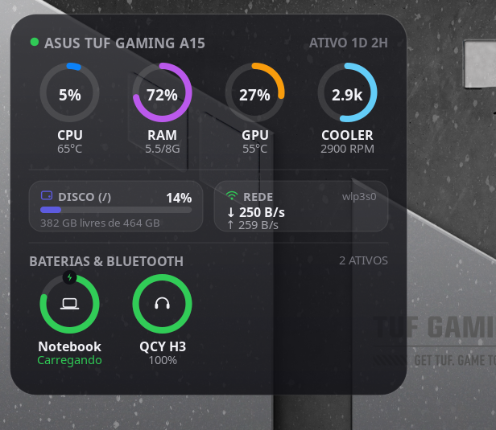

# iOS Hardware & Battery Monitor (`ios-hardware-monitor@dalvan`)

Desklet **All-in-One** para Linux Mint / Cinnamon com estética inspirada nos widgets de **Baterias e Monitor de Atividade do iOS / macOS Sonoma** (anéis circulares *squircle*, tipografia limpa e efeito *glassmorphism* translúcido).



## Recursos Principais

- **Anéis de Hardware em Tempo Real (Sem Dependências Externas)**:
  - **CPU**: Uso percentual (`/proc/stat`) e temperatura do pacote via `hwmon` (`k10temp`, `coretemp`, `zenpower`, `acpitz`).
  - **RAM & Swap**: Uso percentual e GB consumidos (`/proc/meminfo`).
  - **GPU (NVIDIA / AMD / Intel)**: Uso percentual, temperatura e VRAM (via DRM `sysfs` nativo para AMD/Intel ou `nvidia-smi` assíncrono não-bloqueante para GPUs NVIDIA).
  - **Cooler / Fan RPM**: Leitura automática dos sensores de rotação (`fan*_input` no `/sys/class/hwmon`) com indicador em RPM / `k`.
- **Cards Compactos de Armazenamento & Rede**:
  - **Disco**: Barra de progresso horizontal com percentual e GB livres (`Gio.File.query_filesystem_info`).
  - **Rede**: Velocidade de Download (`↓`) e Upload (`↑`) em tempo real na interface ativa (`/proc/net/dev`).
- **Monitor de Baterias + Dispositivos Bluetooth (Estilo iOS Batteries)**:
  - Integração nativa via **UPower (`UPowerGlib`)** e **BlueZ D-Bus (`org.freedesktop.DBus.ObjectManager` / `org.bluez.Battery1`)**.
  - Ícones vetoriais desenhados em Cairo para Notebook, Fones Bluetooth / AirPods, Caixas de Som, Mouse, Teclado, Controles e Celulares, além de badge de carregamento com raio.
  - Cores semafóricas inteligentes do iOS (Verde `#30D158`, Amarelo `#FFD60A` ≤ 25%, Vermelho `#FF453A` ≤ 15%).
- **Personalização Completa (Settings nativo do Cinnamon)**:
  - Temas **Escuro Translúcido (macOS Dark Glass)**, **Claro Translúcido (iOS Light Frosted)** e **Automático**.
  - Ajuste de opacidade, arredondamento das bordas, escala de tamanho (`0.75x` a `1.6x`), colunas por linha e ativação individual de cada módulo.

## Instalação Rápida

### Modo Desenvolvimento (Symlink automático)
```bash
./install.sh --symlink
```

### Instalação Padrão (Cópia para `~/.local/share/cinnamon/desklets`)
```bash
./install.sh
```

## Estrutura do Projeto

- [`ios-hardware-monitor@dalvan/desklet.js`](ios-hardware-monitor@dalvan/desklet.js): Lógica de telemetria e renderização vetorial em Cairo/Pango.
- [`ios-hardware-monitor@dalvan/settings-schema.json`](ios-hardware-monitor@dalvan/settings-schema.json): Esquema de configurações para o painel do Cinnamon.
- [`ios-hardware-monitor@dalvan/metadata.json`](ios-hardware-monitor@dalvan/metadata.json): Manifesto compatível com o Cinnamon Spices.
- [`ios-hardware-monitor@dalvan/icon.svg`](ios-hardware-monitor@dalvan/icon.svg): Ícone vetorial do Desklet.
